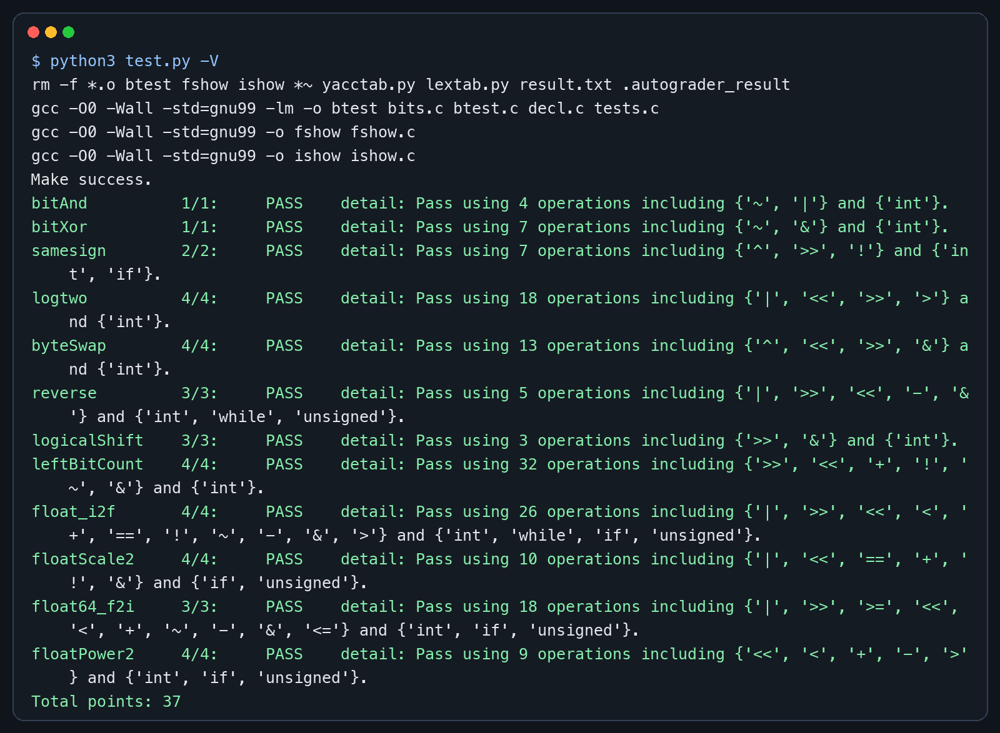

# DataLab 实验报告

姓名：郑好
学号：2025201861

## 实验结果

| 函数 | 得分 | 函数 | 得分 |
| --- | ---: | --- | ---: |
| bitAnd | 1/1 | bitXor | 1/1 |
| samesign | 2/2 | logtwo | 4/4 |
| byteSwap | 4/4 | reverse | 3/3 |
| logicalShift | 3/3 | leftBitCount | 4/4 |
| float_i2f | 4/4 | floatScale2 | 4/4 |
| float64_f2i | 3/3 | floatPower2 | 4/4 |
| **总分** | **37/37** |  |  |

运行 `python3 test.py -V` 后，所有函数均通过正确性和合规性检查。

## 解题报告

### 总体思路

本实验的重点是把算术或逻辑操作拆成对二进制位的处理。实现每个函数时，我先根据题意写出目标位模式，再根据 `Legal ops` 将不能使用的运算替换掉，最后分别用 `btest` 检查结果、用 `test.py -V` 检查操作符和操作次数。

### 亮点

1. `logtwo`：用分段判断代替逐位循环，在操作数限制内快速确定最高位的位置。
2. `leftBitCount`：按 16、8、4、2、1 位逐级缩小范围，避免逐位遍历。
3. `float_i2f`：补充了 IEEE 754 的舍入处理，包括恰好位于中点时向偶数舍入。

### bitAnd

根据德摩根律，`x & y` 等价于 `~(~x | ~y)`。先分别取反，使用允许的按位或合并，最后再取反，就能得到按位与的结果。

### bitXor

异或要求两个 bit 不相同。实现中分别排除“同时为 0”和“同时为 1”的情况，再用按位与合并两个条件，从而只使用 `~` 和 `&` 完成异或。

### samesign

非零整数右移 31 位后可以得到符号信息：非负数为 0，负数为全 1。两个符号异或为 0 时说明同号。由于题目规定 0 既不是正数也不是负数，因此先单独处理含 0 的情况。

### logtwo

正整数的整数部分 `log2` 等于最高有效位的位置。我依次检查高 16 位、高 8 位、高 4 位、高 2 位和最后 1 位；每确定一段，就将输入右移相应长度，并把位移量合并进答案。

### byteSwap

第 `n` 个字节的起始位置是 `n << 3`。先右移并与 `0xff`，取出待交换的两个字节；再计算两字节的异或差值，将该差值分别移回两个位置并与原数异或，即可只改变目标字节。

### reverse

固定循环 32 次。每次取出输入最低位，将当前答案左移一位后拼接该 bit，再把输入右移一位。必须固定执行 32 次，否则输入高位为 0 时会遗漏反转后应出现在低位的 0。

### logicalShift

有符号负数右移时左侧会补 1。先执行普通右移，再用 `0xffffffff >> n` 生成左侧有 `n` 个 0 的掩码，通过按位与清除符号扩展产生的高位 1。

### leftBitCount

目标是统计从最高位开始连续出现的 1。先检查最高 16 位是否全为 1；如果成立就累加 16 并左移，然后依次检查 8、4、2、1 位。该方法类似二分查找，操作次数保持在限制以内。

### float_i2f

先提取符号并得到整数的绝对值，再寻找最高有效位来计算指数。随后将有效数字对齐到单精度浮点数的 23 位 fraction。若有低位被截断，则比较丢失部分和中点，并按照“就近舍入，恰好一半时取偶数”的规则修正尾数，最后组合符号、指数和尾数。

### floatScale2

先提取指数并分类处理。NaN 和无穷保持不变；非规格化数通过左移尾数实现乘 2；普通规格化数将指数加 1；当原指数已经是最大有限指数时，乘 2 后返回带原符号的无穷。

### float64_f2i

`uf2` 保存 double 的符号、11 位指数和 fraction 高 20 位，`uf1` 保存 fraction 低 32 位。先减去偏置 1023 得到真实指数并判断下溢或溢出，再补上规格化数隐藏的最高位 1，根据指数从高低两部分拼出整数，最后按符号转换成补码结果。

### floatPower2

根据单精度浮点数的表示范围分类。指数小于 -149 时结果下溢为 0；从 -149 到 -127 时构造非规格化数；从 -126 到 127 时把 `x + 127` 写入指数域；大于 127 时返回正无穷。

## 调试与验证

我先用 `./btest -f 函数名` 对单个函数进行针对性测试，再运行完整 `./btest`。所有函数正确后，使用 `python3 test.py -V` 检查非法操作符、变量类型和操作次数。最终 12 个函数全部通过，总分为 37/37。

## 反馈、收获与总结

本实验让我更熟悉了补码、移位、掩码和 IEEE 754 表示。开始时容易把“数值运算”和“位模式变换”混在一起，后来先画出目标位模式，再决定掩码和移位方式，思路会清晰很多。浮点题最困难的部分是边界和舍入，需要分别考虑 0、非规格化数、规格化数、无穷和 NaN。

## 参考的重要资料

1. 课程仓库 README：<https://github.com/RUCICS2026/datalab2026>
2. Randal E. Bryant, David R. O'Hallaron, *Computer Systems: A Programmer's Perspective*, Chapter 2.
3. IEEE 754 浮点数概述：<https://en.wikipedia.org/wiki/IEEE_754>
